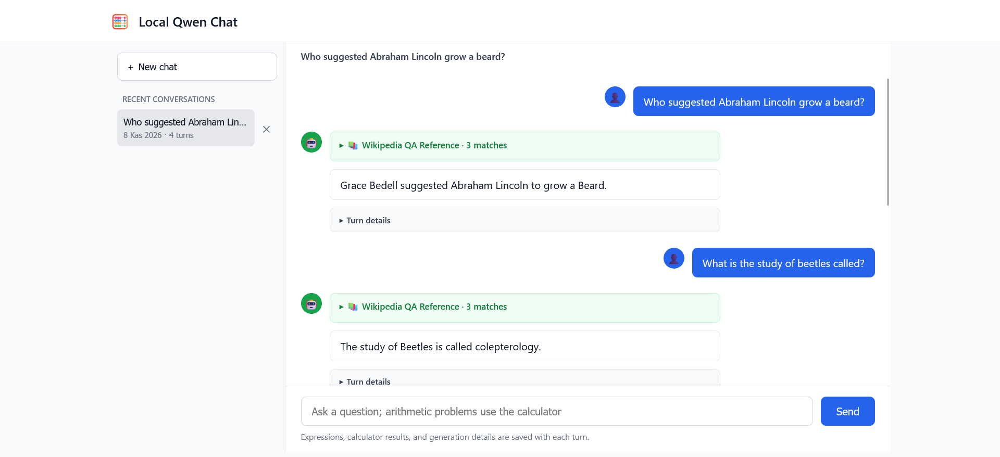

# mylocalmodel

A CUDA-based chat application for Qwen instruct models, with both a command-line interface and a browser-based chat interface. Each turn samples multiple responses, ranks them by temperature-scaled, length-normalized token log-likelihood, and returns the highest-scoring response.

## Features

- Uses the Qwen chat template for system prompts and multi-turn conversation history.
- Generates a configurable Best-of-N batch of candidate responses.
- Scores candidates using the mean log-probability of generated tokens after temperature scaling. The geometric mean token probability is also shown as a percentage.
- Optionally prints scores for all candidates and marks the selected response.
- Can load a model from Hugging Face or from a local model directory.
- Drops the oldest conversation turns when the prompt exceeds the configured context budget.
- Includes a restricted calculator tool for arithmetic, numeric functions, and selected symbolic-calculus operations.
- **Subprocess calculator evaluation** with a hard 2-second timeout to limit runaway computation.
- **AST-based expression validation** with depth, node count, and size limits to mitigate unsafe or pathological inputs.
- **Repetition penalty and n-gram prevention** (configurable penalty, 3-gram blocking) to reduce repetitive generation.
- **Separate generation and calibration temperatures** for independent control of sampling diversity and ranking confidence.
- **Automatic calculator preference** during retry: when tool use is required, the system prefers candidates that include calculator calls.
- Adds calculator instructions and few-shot examples only to prompts classified as requiring math, keeping ordinary factual prompts focused on the user's question.
- Provides a browser chat with persistent conversation history, per-turn generation and tool metadata, and controls to reopen or delete conversations.
- Renders assistant Markdown, fenced code blocks, and inline or display LaTeX in the browser chat. Common unwrapped commands such as `\frac{1}{2}` are automatically given inline math delimiters; generated HTML is sanitized before display.
- **Automated RAG knowledge grounding**: Retrieves factual question-answer context from `rag-datasets/rag-mini-wikipedia` using `sentence-transformers/all-MiniLM-L6-v2` dense embeddings and cosine distance filtering ($D_{\cos} \le 0.65$), with precomputed index caching in `tools/rag_cache/`.
- Renders collapsible RAG reference cards in the browser chat showing retrieved Wikipedia QA pairs, question, answer, cosine distance, and similarity score.
- Keeps conversation contents, calculator audit logs, and RAG cache indices in local files excluded from Git.

## Examples

### Calculator example

For a jacket that costs $80, has a 25% discount, and then 8% sales tax, the calculation is:

```text
<calculator>80 * (1 - 25 / 100) * (1 + 8 / 100)</calculator>
Calculator result: 64.8
```

The final price is **$64.80**. This is the calculator format used in the system's few-shot example.

## Requirements

- Python 3.9 or newer.
- A CUDA-enabled NVIDIA GPU and a PyTorch build with CUDA support. The application exits with an error if CUDA is unavailable.
- Enough GPU memory for the selected model and the batched candidates.

> [!IMPORTANT]
> The default `q4_k_m` GGUF file is loaded through Transformers and dequantized into a float16 PyTorch model for generation and scoring. Its quantized file size does not represent its runtime VRAM use; expect substantially higher GPU memory use than the GGUF file size. This is not llama.cpp inference and does not keep the model in its packed GGUF format.

Python dependencies are listed in `requirements.txt`:

- `torch`
- `transformers`
- `sentencepiece`
- `tiktoken`
- `sympy` (symbolic calculator operations)
- `gguf` (loading GGUF weights through Transformers)
- `fastapi` and `uvicorn` (web interface)
- `datasets` (loading Hugging Face datasets natively)
- `sentence-transformers` (dense vector embeddings for semantic retrieval)
- `tqdm` (progress tracking for embedding calculation)

Install a CUDA-compatible PyTorch build as described in the setup steps below.

## Setup and run

Clone the repository and enter its directory:

```bash
git clone https://github.com/TheOfficialFurkanNar/mylocalmodel.git
cd mylocalmodel
```

Create and activate a virtual environment:

```bash
python -m venv .venv
```

Activate the environment, install the CUDA-compatible PyTorch build using the command from the [official PyTorch installation selector](https://pytorch.org/get-started/locally/), then install the remaining project requirements. The web interface dependencies are included in `requirements.txt`.

```bash
# Windows PowerShell
.venv\Scripts\Activate.ps1
pip install -r requirements.txt

# macOS / Linux
source .venv/bin/activate
pip install -r requirements.txt
```

Start the command-line chat:

```bash
python run.py
```

The default model is `Qwen/Qwen2.5-Coder-1.5B-Instruct-GGUF`, using its `q4_k_m` file. Transformers downloads the model from Hugging Face on the first run unless `local_model_path` is set in `config.py` to a local Transformers model directory. Type `quit` or `exit` to end the session.

To use the web chat with the conversation sidebar, start the API and UI with `python web_backend.py`, then open `http://127.0.0.1:8000` in your browser.

## Configuration

Edit the defaults in `config.py` (`ChatConfig`) before launching. Common settings include:

| Setting | Default                                   | Purpose |
| --- |-------------------------------------------| --- |
| `model_name` | `Qwen/Qwen2.5-Coder-1.5B-Instruct-GGUF`   | Hugging Face model repository |
| `gguf_file` | `qwen2.5-coder-1.5b-instruct-q4_k_m.gguf` | GGUF quantization file loaded from the repository |
| `local_model_path` | empty                                     | Local Transformers model directory; takes precedence over the Hub model and GGUF file |
| `attention_implementation` | `sdpa`                                    | PyTorch scaled dot product attention; uses a fused CUDA attention kernel when supported |
| `best_of_n` | `4`                                       | Number of candidates generated in one batch |
| `max_length` | `8192`                                    | Prompt context budget, including generation allowance |
| `max_new_tokens` | `2048`                                    | Maximum tokens generated per candidate |
| `temperature` | `0.7`                                     | Sampling temperature used during generation |
| `calibration_temperature` | `1.143`                                   | Temperature for scoring (T_gen × T_calib = 0.8 effective) |
| `top_k` / `top_p` | `40` / `0.9`                              | Sampling filters |
| `repetition_penalty` | `1.15`                                    | Penalty factor to reduce repetitive token generation |
| `show_candidate_scores` | `True`                                    | Whether to print candidate scores and token counts |
| `system_prompt` | concise general instructions              | Keeps answers on topic, uses inline LaTeX for equations, and asks for fenced code blocks |
| `calculator_prompt` | calculator syntax and usage instructions  | Added only for recognized math questions, together with calculator examples |
| `enable_rag` | `True`                                    | Whether to automatically retrieve Wikipedia reference QA pairs before generation |
| `rag_max_distance` | `0.75`                                    | Maximum cosine distance threshold ($D_{\cos} \le 0.65$) for accepting retrieved context matches |
| `rag_top_k` | `3`                                       | Maximum number of top context matches injected into the prompt |

`config.py` also defines `RAGConfig` for dataset and retriever settings (`max_cosine_distance = 0.75`, `embedding_model_name = "sentence-transformers/all-MiniLM-L6-v2"`, `dataset_name = "rag-datasets/rag-mini-wikipedia"`, `dataset_config = "question-answer"`, and `cache_dir = tools/rag_cache`).

Lower `best_of_n` or `max_new_tokens` to reduce GPU memory use and generation time. Increasing `best_of_n` samples more candidates, but does not guarantee a better answer; selection relies on the model's own token likelihoods. The `sdpa` attention setting uses PyTorch's scaled dot product attention, which can dispatch to its fused Flash Attention CUDA kernel when the GPU, dtype, and installed PyTorch build support it; otherwise PyTorch selects another supported SDPA kernel. This is distinct from Dao-AILab's standalone FlashAttention-2 package, whose maintainers describe Windows support as experimental.

## Calculator tool

For arithmetic word problems, the application checks that the selected response calls the calculator using `<calculator>expression</calculator>`. If it does not, the model gets one tool-only retry; among retry candidates, the app prefers one that includes a calculator call. The calculator evaluates the expression and returns the result to the model before it writes its answer. The tool tag must contain one math expression only; assignments and `print` calls are rejected. If evaluation fails, the model is asked to retry with a valid expression. If no calculator call is produced or calculation attempts fail, the app returns an explicit failure instead of an unverified numeric answer. Calculator requests are limited to two rounds per response.

### Calculator prompting

Short few-shot examples demonstrate the calculator call format, returned result, and concise answer. Calculator instructions and examples are added only for prompts classified as math questions; recognized calculation prompts get one retry if the model skips the tool. Calculator calls are not executed for questions classified as non-math. The result is supplied to the model before it answers. A valid expression can still encode the wrong interpretation of a word problem, so the calculator verifies arithmetic for the supplied expression but not that the expression matches the question.

## Conversation history

The web app saves conversations locally in `conversation_history.json` and shows them in the left sidebar. Select a conversation to reopen it, start a new conversation, or use its × button to delete it after confirming. Each turn stores the user message, assistant response, UTC timestamp, total response duration, calculator usage and results, model and generation settings, the accepted Best-of-N candidate, and score metadata for each candidate run. Metadata is stored separately from message text and is not added to the model's conversation prompt. The conversation file is ignored by Git because it contains local chat content. The command-line interface keeps its conversation history in memory for the current run only.

## Calculator safeguards

The calculator runs in a **separate subprocess** with a hard 2-second timeout to limit runaway symbolic computations from blocking the main application. This subprocess and timeout are resource controls, not an operating-system security sandbox. Expression evaluation uses **AST parsing** with limits intended to mitigate unsafe or pathological inputs:

- Maximum expression length: 512 characters
- Maximum AST node count: 100 operations
- Maximum AST depth: 20 nesting levels
- Maximum exponent magnitude: 10,000
- Maximum output length: 2,000 characters

These restrictions mitigate risk while supporting practical mathematical operations. The calculator does not use Python `eval`; it evaluates a restricted subset of operations through a custom AST walker.

Each calculator call is also appended to `calculator_calls.jsonl` in the project directory. Records include the UTC timestamp, original question, expression, success or failure, result or error, and elapsed time. This local audit log is not inserted into the model prompt or conversation history and is ignored by Git.

The calculator parses a restricted Python-like math syntax; it does not call Python `eval`. It supports `+`, `-`, `*`, `/`, `//`, `%`, parentheses, `^` as exponentiation, and the constants `pi`, `e`, and `tau`. Trigonometric functions use radians. Numeric functions include `sqrt`, `log`, `pow`, `max`, `min`, `abs`, `sin`, `cos`, `tan`, `exp`, `ceil`, `floor`, and `round`; aggregate functions include `sum`, `prod`, and `mean`.

Selected SymPy operations are also available:

| Operation | Example |
| --- | --- |
| Derivative | `diff(x^3, x)` |
| Indefinite integral | `integrate(sin(x), x)` |
| Definite integral | `integrate(x^2, x, 0, 1)` |
| Limit | `limit(sin(x)/x, x, 0)` |
| Numeric approximation | `approx(sqrt(2), 30)` |

Inputs are restricted by expression length, syntax depth, exponent size, and result size. Symbolic evaluation runs in a separate process that is terminated when the time limit expires. These safeguards reduce risk but do not make every symbolic problem easy or guarantee that a returned mathematical result is correct; review important results.

## Retrieval-augmented generation (RAG)

When `enable_rag` is `True` (the default), each user message is first used as a query against a local retrieval index built from `rag-datasets/rag-mini-wikipedia` (`question-answer` split) via the Hugging Face `datasets` library. The retriever embeds every question-answer pair once with `sentence-transformers/all-MiniLM-L6-v2` (384-dimensional, L2-normalized) and caches the index in `tools/rag_cache/rag_mini_wiki_qa_index.pt`; subsequent runs load the cached index instead of re-embedding the dataset.

At query time, the user message is embedded with the same model and compared to the index by cosine distance ($D_{\cos} = 1 - \text{cosine similarity}$). Matches with $D_{\cos} \le$ `rag_max_distance` (default `0.65`) are kept, sorted by distance ascending, and the top `rag_top_k` (default `3`) are formatted as a `[Wikipedia QA Reference Context]` block and prepended to the user message inside the chat prompt. Retrieved context is treated as reference material only — it is not inserted into conversation history, and the model is not explicitly instructed to cite or obey it.

In the web interface, each assistant turn's metadata records whether RAG was used (`rag_used`) and the retrieved matches (question, answer, distance, similarity), rendered as collapsible reference cards. The RAG index cache and embedding model download are local-only artifacts and are excluded from Git.

RAG retrieval runs once per user turn, before the Best-of-N generation batch, so its latency is paid once regardless of `best_of_n`. If the embedding model or dataset cannot be loaded, the application logs a warning and continues without RAG rather than failing.

## Project files

- `run.py` — model loading, prompt construction, batched generation, response selection, and interactive CLI.
- `web_backend.py` — FastAPI chat API, Best-of-N web generation, calculator flow, and local conversation persistence.
- `static/` — web chat UI with conversation history and per-turn calculator/candidate metadata.
- `config.py` — model, generation, scoring, and stop-sequence settings.
- `calibration.py` — temperature scaling, length-normalized candidate scoring, and confidence metrics computation.
- `tools/calculator.py` — restricted arithmetic and SymPy calculus evaluator with AST-based validation.
- `tools/calculator_worker.py` — subprocess entry point for calculator evaluation with a timeout.
- `requirements.txt` — Python dependencies.
- `LICENSE` — MIT License.

## How candidate selection works

For each sampled candidate, let the prompt be $x$, and let its generated token sequence be $y_1, \ldots, y_L$. At generation step $t$, the model produces a vocabulary-sized score vector $z_t \in \mathbb{R}^{|V|}$. In this implementation, $z_t$ is the score vector returned by Transformers during generation, after generation-time processing such as sampling temperature, top-k/top-p filtering, and repetition penalty. The candidate scorer applies a second temperature scaling, using the configured calibration temperature $T_{\mathrm{calib}} > 0$:

$$
p_t^{(T)}(v) = \mathrm{softmax}\!\left(\frac{z_t}{T_{\mathrm{calib}}}\right)_v
= \frac{\exp(z_{t,v}/T_{\mathrm{calib}})}
       {\sum_{u \in V}\exp(z_{t,u}/T_{\mathrm{calib}})},
\qquad v \in V.
$$

Here, $p_t^{(T)}(y_t)$ is the probability assigned at step $t$ to the token that the candidate actually generated. The code sums the log of those probabilities and divides by the number of unmasked generated tokens. If $M$ is the set of generated positions whose token ID is not the tokenizer's pad token ID, the implemented score is:

$$
S(x,y) = \frac{1}{|M|}\sum_{t \in M}\log p_t^{(T)}(y_t)
       = \frac{1}{|M|}\sum_{t \in M}
         \log\!\left(
           \frac{\exp(z_{t,y_t}/T_{\mathrm{calib}})}
                {\sum_{v \in V}\exp(z_{t,v}/T_{\mathrm{calib}})}
         \right).
$$

Among the $N$ candidates, the selected response is:

$$
y^* = \arg\max_{i=1,\ldots,N} S(x,y^{(i)}).
$$

The division by $|M|$ makes this a mean log-probability per scored token rather than a total log-probability, reducing the automatic preference for shorter sequences that a sum would create. Exponentiating the mean gives the geometric mean of the selected-token probabilities:

$$
G(x,y) = \exp(S(x,y))
        = \left(\prod_{t \in M}p_t^{(T)}(y_t)\right)^{1/|M|}.
$$

This value is what the CLI displays as `geom_mean_prob` (as a percentage). Higher $T_{\mathrm{calib}}$ softens the distribution and lower values make it peakier; it changes the scores and can change the ranking. Because $z_t$ already reflects generation-time processing, this score is specifically the likelihood under the processed generation scores after calibration scaling, not an independent evaluation using the model's unmodified logits. It is a model-based ranking signal, not a calibrated measure of factual correctness or answer quality. The score mask excludes every generated token whose ID equals `pad_token_id`. If a tokenizer uses the same ID for padding and EOS, the EOS token is therefore excluded as well. In the configured Qwen2.5-Coder-1.5B-Instruct tokenizer, padding is `<|endoftext|>` and the tokenizer's EOS is `<|im_end|>`, so the normal EOS token is distinct and remains part of the score; `<|endoftext|>` tokens are masked.

## Limitations and example session

Best-of-N selection ranks candidates using model token likelihoods, not factual verification. A high-scoring candidate can still contain errors, as in this recorded web-chat session from `conversation_history.json`. Candidate score output is omitted; the following is the user and assistant message text, with selected metadata noted.



~~~text
You: Who suggested Abraham Lincoln grow a beard?

AI: Grace Bedell suggested Abraham Lincoln to grow a Beard.

You: What is the study of beetles called?

AI: The study of Beetles is called colepterology.

You: Why does this field of study matter

AI: Colepterologists study beetles because they help us understand their behavior, ecology, and evolution. They also use beetle research to develop new tools and techniques in various fields such as agriculture, medicine, and environmental science.

You: How does it contribute to our lives

AI: Beetle research contributes to our life by providing valuable information about the natural world and its inhabitants. It helps us better understand how different species interact with each other and how they adapt to changing environments. Additionally, beetle research can be used to develop sustainable agricultural practices that reduce pesticide usage and conserve biodiversity.
~~~

RAG supplied a near-exact Wikipedia QA match for the first two questions (cosine distances `0.1749` and `0.1622`), and both factual answers are essentially correct. The last two questions retrieved no context within the distance threshold and were answered from model parameters alone.

**Accuracy note:** The second answer misspells the field's name — the correct term is **coleopterology** (the model consistently writes "colepterology"/"Colepterologists" in later turns). The first answer is correct: 11-year-old Grace Bedell did suggest Lincoln grow a beard. This illustrates that RAG grounding and high candidate scores improve factual answers but do not guarantee correct spelling, terminology, or reasoning.

## Notes

- The implementation loads the full model onto the CUDA device; it does not currently configure quantization, CPU offloading, or automatic device mapping.
- EOS ends generation normally. Configured stop strings are removed from decoded output after generation, so generation may continue beyond a configured stop string until EOS or the token limit.

## License

This project is distributed under the MIT License. See `LICENSE` for details.
